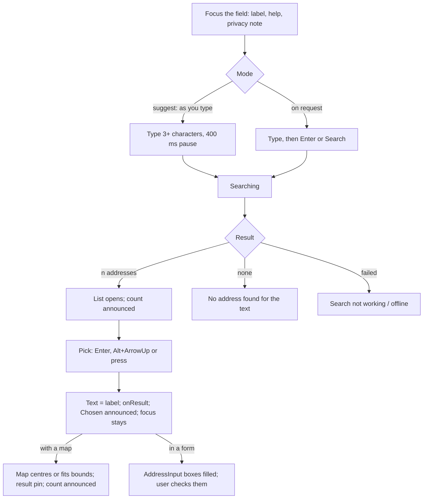

# Design spec: AddressSearch

<!-- kv-lang-ok-file: names of Nordic places and national address services (Lantmäteriet, Kartverket, Malmö) and a sample address in the wireframe -->

- **Status:** Draft · **Designer:** ux-designer agent · **Date:** 2026-10-19
- **Plan:** [0117](plans/0117-map-and-address-search.md) (P4a; D12 "AddressSearch on Autocomplete", rule 7, the Nominatim risk)
- **Type:** component flow, content and default styling (`@kvirn-ui/map`; CSS in `@kvirn-ui/theme/map.css`)
- **Builds on:** [combobox.md](combobox.md) and `autocomplete.a11y.md` (the field, popup and keys), [map.md](map.md) (the halo, `map.show`), [phone-and-address-inputs.md](phone-and-address-inputs.md) (AddressInput, 3.3.7)

## 1. Brief

- **Users:** both. Residents find where a place is, or fill in their own address, once and under stress, often on a phone. Staff look up addresses daily on a desktop with the keyboard.
- **Hardest cases:** a screen-reader user who must hear that a search is running, how many addresses came back and what the pick did to the page; a second-language reader who types "Storgatan 1" without the town; a tremor user whose press must not land on a list that just changed; a phone user on a slow or dropped connection.
- **Job:** "When I know an address, I want to type it and pick the right one, so the map shows it (or the form is filled in) without typing it again."
- **Constraints:** rule 7 (no geocoder URL ships; nothing is sent until the visitor types and a provider is mounted); GDPR (the query is personal data when it is the visitor's own address, so the page says where it goes); Nominatim's usage policy forbids client-side autocomplete and allows at most 1 request per second ([OSMF policy](https://operations.osmfoundation.org/policies/nominatim/)); rule 4 (every string an i18n key).
- **Success:** the right address is picked on the first try; no submit of an unresolved search; no silent state (searching, nothing found, failure are each seen and heard).
- **Evidence:** none from KvirnUI users. Everything below without a source is an assumption.
- **Assumptions → research questions:**
  - A visible Search button is found and understood on a phone. → Do participants press it, or the keyboard's Search key, or wait for suggestions?
  - "Chosen: …" after a pick is not doubled by the screen reader reading the new value. → AT run (§8).

**When not to use it:** to collect a postal address the user knows by heart (use AddressInput alone: a lookup adds a step and a third party); when the answer must come from your own register (use a Combobox over your data); for free-text site search (use the site search).

## 2. Prior art

| Source                                             | Reuse                                                                                             | Change and why                                                                               |
| -------------------------------------------------- | ------------------------------------------------------------------------------------------------- | -------------------------------------------------------------------------------------------- |
| KvirnUI Autocomplete (`autocomplete.a11y.md`)      | The whole field: ARIA 1.2 combobox, keys, `aria-activedescendant`, popup, debounced announcements | Server results (`filter={false}`, `isLoading`); Enter with nothing active searches (§3, D1)  |
| APG Editable Combobox With List Autocomplete       | Structure and keys, unchanged                                                                     | None                                                                                         |
| GOV.UK "Addresses" pattern and its postcode lookup | Lookup on request with a visible button; manual entry stays available                             | One page, not two: the lookup sits above the AddressInput boxes, which stay editable (3.3.7) |
| Nominatim usage policy                             | No search-as-you-type against it; cache; attribution shown                                        | Drives the on-request mode (D2)                                                              |

## 3. Flow



| State     | Trigger                                                         | Shown (popup status line)   | Announced (polite)          | Root `data-status` |
| --------- | --------------------------------------------------------------- | --------------------------- | --------------------------- | ------------------ |
| idle      | empty text, or text not yet searched                            | nothing                     | nothing                     | `idle`             |
| too short | as you type: fewer than `minLength`; on request: Enter/Search   | on request only: `tooShort` | on request only: `tooShort` | `too-short`        |
| searching | request sent (earlier results stay listed, nothing moves)       | spinner icon + `searching`  | `searching` (debounced)     | `searching`        |
| results n | the latest request returned n ≥ 1                               | the list                    | `resultCount`               | `results`          |
| none      | returned 0                                                      | `noResults`                 | `noResults`                 | `empty`            |
| error     | rejected (not aborted), or no answer in 10 s                    | error icon + `error`        | `error`                     | `error`            |
| offline   | `navigator.onLine === false` at send, or a network failure then | `offline`                   | `offline`                   | `offline`          |
| selected  | a pick                                                          | text = label; Clear shown   | `picked` (+ the map's, §6)  | `selected`         |

- **Ordering:** each keystroke or Search aborts the request in flight (`signal`); only the latest answer is shown. Typing after a pick keeps the pin and the last result until a new pick or Clear (`onResult(null)`).
- **Enter**, the one row that differs from Autocomplete:

| Context                          | Enter with a suggestion active | Enter with none active, or popup closed                                                                                                      |
| -------------------------------- | ------------------------------ | -------------------------------------------------------------------------------------------------------------------------------------------- |
| Standalone (no form)             | Picks it (inherited)           | **Searches now:** flushes the debounce. Text unchanged since the last answer: reopens that list without activating and re-announces it       |
| Inside a `<form>` (`input.form`) | Picks it (inherited)           | **The same, and the form is not submitted** (D1): the text is a lookup, not an answer. The form's own submit button stays the way to send it |

## 4. Content

`addressSearch.*` keys, English final; sv, fi, nb, nn follow (nb and nn drafts for a native reviewer). Length check with the longest fi string at 320px before approval.

| Key                            | en                                                                                                      | Shown / announced  | Notes                                                           |
| ------------------------------ | ------------------------------------------------------------------------------------------------------- | ------------------ | --------------------------------------------------------------- |
| `addressSearch.label`          | Find an address                                                                                         | label              | Default for `label`; a form says "Find your address"            |
| `addressSearch.helpSuggest`    | Type at least {min} characters of a street, postal code or place. Then choose an address from the list. | help text          | As-you-type mode                                                |
| `addressSearch.helpRequest`    | Type a street and number, a postal code or a place. Then press Search.                                  | help text          | On-request mode. "press" covers tap, click and Enter            |
| `addressSearch.submit`         | Search                                                                                                  | button             | On-request mode; a text button, not icon-only (residents)       |
| `addressSearch.privacy`        | What you type is sent to {service} to find the address.                                                 | notice             | `{service}` = `geocoder.name`                                   |
| `addressSearch.privacyUnnamed` | What you type is sent to an address service to find the address.                                        | notice             | When the geocoder has no name                                   |
| `addressSearch.tooShort`       | Type at least {min} characters to search.                                                               | status + announced | On request only; as you type, the help text already says it     |
| `addressSearch.searching`      | Searching for addresses                                                                                 | status + announced |                                                                 |
| `addressSearch.resultCount`    | 1 address found / {count} addresses found                                                               | announced          | `format.plural`, `format.number`                                |
| `addressSearch.noResults`      | No address found for "{query}". Check the spelling, or add the town.                                    | status + announced | Locale quotes (sv ”…”, nb «…»). Not an error: no `aria-invalid` |
| `addressSearch.error`          | The address search isn't working right now. Try again in a moment.                                      | status + announced | A form's help text adds "or type it in the boxes below"         |
| `addressSearch.offline`        | You're offline. Connect to the internet, then search again.                                             | status + announced |                                                                 |
| `addressSearch.picked`         | Chosen: {label}.                                                                                        | announced          |                                                                 |
| `addressSearch.pickedFilled`   | Chosen: {label}. The address is filled in below. Check it before you continue.                          | announced          | The form example passes it as `messages.picked` per instance    |
| `map.addressShown`             | The map shows the address. {count}                                                                      | announced          | New `map.*` key; `{count}` is `map.placesInView`'s text         |

Clear keeps `combobox.clear`, named "Clear, Find an address" by `aria-labelledby` (combobox.md m2).

## 5. Structure and API

```tsx
// standalone, beside a map (the consumer wraps it in <search>, D6)
<search>
  <AddressSearch geocoder={geocoder} onResult={(r) => (r ? map.show(r) : map.clearResult())} />
</search>
// parts, for your own order: Root, Label, Control (Input, Clear, Submit), HelpText, Notice, Popup (List, Option, Status)
```

| Prop        | Default               | Meaning                                                                                        |
| ----------- | --------------------- | ---------------------------------------------------------------------------------------------- |
| `geocoder`  | required              | `GeocoderProvider`. Nothing is sent before the visitor types (and, on request, presses Search) |
| `onResult`  | none                  | `(result: AddressResult \| null)`; `null` on Clear or emptied text. Never moves focus (3.2.2)  |
| `minLength` | 3                     | Trimmed characters (graphemes) before a search                                                 |
| `debounce`  | 400 (ms), or `false`  | `false`, or a geocoder without `suggest: true`, gives the on-request mode (D2)                 |
| `label`     | `addressSearch.label` | The visible label's text                                                                       |

`useAddressSearch(options)` returns Autocomplete's prop getters plus `status`, `results`, `search()` and `submitProps`. No presentation props (rule 14).

Wireframe, the same at 320px, 40rem and 64rem (full width of its column, max the 40rem form column; the popup as wide as the Control):

```
Find an address                         ← label
[ Storgatan 1            ×  | Search ]  ← Control: input, Clear (no Tab stop), Submit (Tab stop, on request)
Type a street and number, a postal code or a place. Then press Search.   ← help text
What you type is sent to Lantmäteriet to find the address.                ← notice (+ attribution)
┌───────────────────────────────────────┐
│ ◌ Searching for addresses              │  ← status line, then up to 6 options
│ ▌Storgatan 1, 211 22 Malmö             │
│  Storgatan 1, 411 38 Göteborg          │
└───────────────────────────────────────┘
```

In a form: inside the address `Fieldset`, before the AddressInput lines: legend "Your address", AddressSearch ("Find your address", help "…or type it in the boxes below"), then street, line 2, postal code, city. Reading order = Tab order: input, Submit, then the boxes. Standalone: before `Map.Root`, so the result lands where the user looks next.

**AddressInput hand-off (3.3.7):** `onResult` writes `result.address` (`line1`, `postalCode`, `city`, `country`, D3) into the consumer's AddressInput values. The boxes stay editable, the values are never re-asked, focus stays on the search, and `pickedFilled` says what happened. A result without `address` fills nothing; the docs say so.

## 6. Visual specification

| Part                                         | Tokens / style                                                                                                                                                                                        |
| -------------------------------------------- | ----------------------------------------------------------------------------------------------------------------------------------------------------------------------------------------------------- |
| Field, Control, Input, Clear                 | Autocomplete's exactly (`kv-autocomplete-*`): `border-control`, `md`, 44px, no Toggle (combobox.md D6)                                                                                                |
| Submit `kv-address-lookup-submit`            | The input group's button look inside the Control (divider, `primary-subtle` hover, `text` label, 44px), not icon-only                                                                                 |
| Help text, Notice `kv-address-lookup-notice` | `Field.HelpText` look: `body-small` in `text`, never `text-muted`. The notice may hold the geocoder's attribution link (`link`)                                                                       |
| Popup, options                               | The Listbox popup: level 3, 6.5-row limit, bar + fill for active. The adapter's default `limit` is 6, so all show without scrolling                                                                   |
| Status line `kv-address-lookup-status`       | `kv-listbox-empty` (`body` in `text`) with a 1rem library icon: `spinner` (crawl class under no-preference motion), `error`, `info` (offline), all `aria-hidden`                                      |
| Result pin `kv-map-search-result`            | On the map: the library `pin`, 2.25rem, `text` fill with a `canvas` dot in the head, the halo (`--kv-map-halo`). Not interactive, `aria-hidden`, `pointer-events: none`, below the markers in z-order |
| `kv-map-location` (Locate, not built)        | Reserved for "you are here": a disc, never a pin, so the two differ by shape. Specified with Locate                                                                                                   |

**States:** the field's are Autocomplete's (rest, hover, focus, disabled; never invalid from a search). Submit: rest, hover `primary-subtle`, focus ring inset, disabled with the field. Root `data-status` and Popup `data-loading` carry state; a search never changes colour alone.

**Modes:** dark and contrast themes use the same tokens (all measured pairs). Forced colours: the pin `CanvasText` with a `Canvas` dot and edge (`forced-color-adjust: none`); status icons `currentColor`; Submit `ButtonText` on `ButtonFace` with a `ButtonBorder` divider. RTL: Clear and Submit at the inline end, in that order; no icon to mirror. Motion: the spinner crawls only under no-preference; the map jumps (D7 of map.md). 320px / 400% / 1.4.12: the label, help and notice wrap; Submit keeps its word and the input shrinks to at least 10 characters, then Submit wraps below the Control (no clipping).

**New tokens or colour pairs:** none. Needed CSS (engineering): `kv-address-lookup-submit`, `-status`, `-notice` (in `theme.css`, shared with AddressInput), `kv-map-search-result` (`map.css`).

## 7. Accessibility annotations and draft contract

Inherited unchanged from `autocomplete.a11y.md` (tested there, not again): roles and states, Tab, Shift+Tab, typing, ArrowDown/Up, PageDown/Up, Home/End, Left/Right, Alt+ArrowDown/Up, Enter on an active suggestion, Escape, Tab with the popup open, pointer press and move, the label click, focus never trapped, popup never covering the field (2.4.11). Clear keeps `tabindex="-1"`.

Rows that each need a named test in `packages/map/src/address-search.test.tsx` (memory geocoder, fake timers, no network):

| #   | Row                                                                                                                             | SC                  |
| --- | ------------------------------------------------------------------------------------------------------------------------------- | ------------------- |
| 1   | Renders the ARIA 1.2 combobox, named by the visible label, described by help text then notice                                   | 1.3.1, 4.1.2, 2.5.3 |
| 2   | Nothing is sent on mount, focus or with empty text                                                                              | rule 7              |
| 3   | As you type: below `minLength` no request is sent and nothing is announced                                                      | 4.1.3               |
| 4   | As you type: one request after `debounce` ms of no typing, not one per keystroke                                                | plan risk           |
| 5   | A new keystroke aborts the request in flight; a late answer for old text is never shown                                         | 3.2.2               |
| 6   | On request (`debounce={false}` or a geocoder without `suggest`): typing sends nothing; Enter or Search sends one request        | Nominatim policy    |
| 7   | On request: Enter or Search below `minLength` shows and announces `tooShort`, sends nothing                                     | 3.3.2, 4.1.3        |
| 8   | Searching: status shown, `searching` announced, earlier options stay in place                                                   | 4.1.3               |
| 9   | n results: options listed, `resultCount` announced once after the answer, nothing active                                        | 4.1.3               |
| 10  | No results: `noResults` with the query shown and announced; `aria-expanded="false"`; no `aria-invalid`                          | 4.1.3, 3.3.1        |
| 11  | Rejection or 10 s without answer: `error` shown and announced; the text stays                                                   | 4.1.3               |
| 12  | Offline: `offline` shown and announced, no request sent                                                                         | 4.1.3               |
| 13  | Enter, none active, standalone: searches now (flushes the debounce)                                                             | 2.1.1               |
| 14  | Enter, none active, inside a form: searches now and the form does not submit                                                    | 3.2.2               |
| 15  | Enter, text unchanged since the last answer: reopens the list without activating, re-announces the count                        | 4.1.3               |
| 16  | Submit is a native `type="button"`, one Tab stop after the input, never submits a form                                          | 2.1.1, 2.4.3        |
| 17  | Pick (Enter, Alt+ArrowUp, press): text becomes the label, `onResult(result)` once, focus stays on the input, `picked` announced | 3.2.2, 4.1.3        |
| 18  | Clear: text emptied, `onResult(null)`, focus on the input                                                                       | 3.2.2               |
| 19  | With a map: `show(result)` fits `bounds` or centres, draws the pin, keeps focus, announces `map.addressShown` once settled      | 3.2.2, 4.1.3        |
| 20  | `clearResult()` removes the pin and announces nothing                                                                           | 4.1.3               |
| 21  | Form hand-off: `result.address` fills the AddressInput boxes, which stay editable                                               | 3.3.7               |
| 22  | Every string comes from `addressSearch.*` and is overridable per instance                                                       | rule 4              |
| 23  | axe clean in every story state (idle, searching, results, none, error, offline, selected, in a form) in 4 themes                | all                 |

Announcement timing: the Autocomplete Announcer, about 500 ms after the last change, polite; `searching` is dropped if the answer arrives first; `picked` is said at once; `map.addressShown` follows the map's settle (about 500 ms after the view stops). The active option is never announced by us.

**WCAG SCs:** 1.1.1, 1.3.1, 1.4.1, 1.4.3, 1.4.10, 1.4.11, 1.4.12, 2.1.1, 2.1.2, 2.4.3, 2.4.6, 2.4.7, 2.4.11, 2.5.3, 2.5.8, 3.2.1, 3.2.2, 3.3.2, 3.3.7, 3.3.8 (paste allowed, no test of memory), 4.1.2, 4.1.3. 1.3.5 n/a for the lookup itself (`autocomplete="off"`); the AddressInput boxes carry the tokens.

**Privacy for the docs (rule 7):** the library names no URL and sends nothing until a geocoder is mounted and the visitor types (or presses Search). The query goes only to the consumer's geocoder. The `nominatim` sub-entry takes the consumer's `url`, declares `suggest: false`, caches answers for the session and requests 6 results; its docs say a self-hosted or paid geocoder is the production path.

## 8. Validation

- [x] Self-review against `review-checklist.md`: every state has text and an announcement; no colour-only state; 44px targets; no placeholder label; no new colour pair; no compliance claim.
- [ ] Contrast: no new pair, so `theme:check` covers it unchanged.
- [x] Usability test plan written. Result: `pending`. AT runs: `pending`.

**Usability test plan.** Participants (8): NVDA, VoiceOver iOS and TalkBack users; a 400% magnifier user; a tremor user; an older person with low digital confidence; a Finnish or Swedish second-language reader; a staff user. Tasks: (1) find "your library" by its address on the map; (2) type an address without a town and recover from "No address found"; (3) fill your address in a form with the lookup, then correct the postal code; (4) search with the network off; (5) staff: five lookups in a row by keyboard. Measure: completion and wrong picks, whether the Search button is found on a phone, whether "Chosen" is heard twice, whether participants expect Enter to submit the form, time to recover from no result and offline.

## 9. Open questions for the maintainer

1. **D1 Enter in a form searches, never submits.** Recommend yes: a submit with an unresolved lookup sends a resident to an error summary mid-task. Cost: staff lose implicit submission from this one field. Alternative: browser's own Enter in a form, as Autocomplete.
2. **D2 On-request is the default.** Recommend: as you type only when the geocoder declares `suggest: true` and `debounce` isn't `false`; `nominatim` declares `false` (its policy forbids client autocomplete). Default `debounce` 400 ms, `minLength` 3.
3. **D3 Type additions in `core/map/types.ts`:** `GeocoderProvider { name?, attribution?, suggest? }`, `search(query, { signal, locale })`, `AddressResult.address?: { line1, postalCode, city, country }`. Recommend yes, in P4b.
4. **D4 Map API:** `show(result)` draws the result pin and announces `map.addressShown`; a new `clearResult()`. Recommend yes; today `show` only moves the camera.
5. **D5 Pick announcement** may double with the screen reader's own reading of the new value. Recommend keep `picked` (silence is worse), verify in the AT run.
6. **D6 Landmark:** Root renders a `div`; the standalone docs wrap it in `<search>`. Recommend yes (the consumer owns the markup; a search landmark is wrong inside a form).
7. **D7 Package:** a form-only AddressInput hand-off imports `@kvirn-ui/map` without any engine. Recommend keep it there for now, and revisit if forms use it more than maps.
8. **D8 Status only in the popup:** Escape hides "No address found" and error. Recommend accept; research question 2 checks it.
