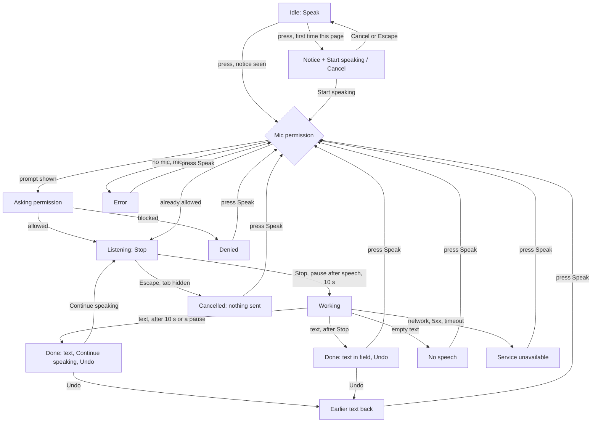

# Design spec: Dictation (speak a short query into a text field)

- **Status:** Draft, revised with the maintainer's decisions and the accessibility review of 2026-10-23 (§9) · **Designer:** ux-designer agent · **Date:** 2026-10-23
- **Plan:** 0152 (to be written from this spec). Service side: `kvirn-voice-provider/docs/plans/0002-phase-2-speech-input.md` (approved 2026-10-23)
- **Type:** component default styling + flow (a button inside `InputGroup`, a notice, a status line)
- **Fixed by the service plan:** own capture (no Web Speech API); a toggle that also stops on silence or at 10 s; final text only; never auto-submit; `lang` from the field or page; audio only to the consumer's configured service; v1 languages sv, nb, en.

## 1. Brief

- **Users:** residents first, staff second. **Hardest cases:** a resident with dyslexia or a tremor who can't spell the service's name, on a 320px phone, once; an NVDA or VoiceOver user whose screen reader talks while the mic is open; a Dragon, Voice Control or Voice Access user who already has dictation; a second-language speaker the model hears badly; a person who pauses or stammers.
- **Job:** "When I can't easily type what I'm looking for, I want to say it, see it written, fix it and search, so I find the page without spelling it."
- **Context:** a site or service search field, a short query (1–8 s), possibly a noisy room, often the first and only use.
- **Constraints:** GDPR (voice is personal data; the site is controller, the service its processor: counsel, §9); WAD; rule 7 (nothing is sent until a provider is mounted and the visitor presses Start).
- **Success:** a participant who can't spell the query completes the search; nobody searches a wrong transcript without seeing it; nobody believes the mic is on when it isn't, or off when it is; screen-reader and voice-control users are not worse off than without the button.
- **Evidence:** the research report and its requirements sheet (`kvirn-voice-provider/docs/reports/Nordic speech to text for search.md`, `research_notes/…/ux_a11y_privacy.md` §5). No Nordic or GOV.UK voice-search component was found. No test of ours exists.
- **Assumptions → research questions** (all T7, `pending`):
  - Screen-reader speech is picked up by the mic despite `echoCancellation` → how often, per reader, with speakers and with a headset?
  - A pause of 2 s ends many queries too early for people who stammer or think aloud → what pause works?
  - Voice-control commands ("click Stop") end up in the transcript → how often, and do those users want our button at all?

## 2. Prior art

| Source                                                 | Reused                                                                        | Changed, and why                                                                              |
| ------------------------------------------------------ | ----------------------------------------------------------------------------- | --------------------------------------------------------------------------------------------- |
| APG Button pattern                                     | A native `button`; a button whose label changes carries no `aria-pressed`     | We change the label (Speak → Stop) rather than press a toggle: "Stop" says how to end it (§7) |
| KvirnUI InputGroup button (form-fields.md §6.13)       | Flat segment, 1px divider, 44px, own ring, Clear named with the field's label | A listening state with the pressed-toggle fill                                                |
| KvirnUI copy-button.md                                 | A status line after the button: words + decorative icon, name never moves     | Status persists until the field changes (it is an instruction to check the text)              |
| KvirnUI address-search / address-input                 | The `{service}` notice from the provider's `name`, and the "filled in" note   | Shown on the first press, not always: most visitors of a search never speak                   |
| KvirnUI Busy (DESIGN.md Words)                         | `aria-disabled` + `data-busy` while waiting, focus kept                       | –                                                                                             |
| OS dictation (macOS, iOS, Gboard), Google voice search | Mic icon, text shown for review                                               | No auto-submit (3.2.2); text never claimed correct                                            |
| W3C NAUR note, AEPD (2026-04-20)                       | Optional input method; notice before recording; visible indicator             | –                                                                                             |

## 3. Flow



- **Unsupported** (no `getUserMedia` or recorder, not a secure context, a frame without `allow="microphone"`, or the field's `lang` not in the provider's list): the button is **not rendered**. The field is complete without it, so nothing is lost and no dead control is shown. A dev warning names the reason.
- **Never auto-submit.** Every path ends in the field; the visitor presses Search or Enter.
- **Silence stop** only after speech has been heard (before that, only Stop, Escape or 10 s end it). Pause: 2 s by default (§9 D5), tested in T7.
- **Continue speaking** (2.2.1, §9 D4): after the 10 s cap or a silence stop, the done line offers it. It records again and **appends** the new words to the field after one space, as often as the visitor likes. Speak keeps replacing.
- **Page hidden** (tab switch, screen lock) while listening: cancel, nothing sent, mic released.

## 4. Content

Namespace `dictation`. English only here; translations later (`fi` length check when it is written, §5 budget). `{service}` = the provider's `name` (`kvirnVoice({ url, name })`, as `kvirnGeocoder`).

| i18n key                   | en                                                                                                                 | Where                                             |
| -------------------------- | ------------------------------------------------------------------------------------------------------------------ | ------------------------------------------------- |
| `dictation.speak`          | Speak                                                                                                              | Button label, idle and every end state            |
| `dictation.stop`           | Stop                                                                                                               | Button label while listening                      |
| `dictation.notice`         | What you say is sent to {service} to be turned into text.                                                          | Notice, sentence 1                                |
| `dictation.noticeUnnamed`  | What you say is sent to a speech-to-text service to be turned into text.                                           | Notice, when the provider has no `name`           |
| `dictation.noticeHow`      | Your browser will ask to use the microphone. Speak for up to 10 seconds, then press Stop or pause.                 | Notice, sentence 2                                |
| `dictation.start`          | Start speaking                                                                                                     | Notice button                                     |
| `dictation.cancel`         | Cancel                                                                                                             | Notice button                                     |
| `dictation.permission`     | Allow the microphone in the box your browser shows.                                                                | Status + announced                                |
| `dictation.listening`      | Listening. Say your words, up to 10 seconds. Press Stop when you're done.                                          | Status (visible only)                             |
| `dictation.listeningShort` | Listening                                                                                                          | Announced at start (one word: the mic is open)    |
| `dictation.working`        | Turning what you said into text.                                                                                   | Status + announced                                |
| `dictation.done`           | Your words are in the field. Check them and correct any mistakes.                                                  | Status (visible)                                  |
| `dictation.doneAnnounce`   | In the field: {text}. Check it and correct any mistakes.                                                           | Announced                                         |
| `dictation.doneAtLimit`    | Stopped after 10 seconds. In the field: {text}. Press Continue speaking to add more, or type.                      | Status + announced                                |
| `dictation.donePaused`     | Stopped when you paused. In the field: {text}. Press Continue speaking to add more, or type.                       | Status + announced (silence stop)                 |
| `dictation.continue`       | Continue speaking                                                                                                  | Button in the `doneAtLimit` / `donePaused` line   |
| `dictation.listeningMore`  | Listening. Say more, up to 10 seconds. Press Stop when you're done.                                                | Status while continuing (visible only)            |
| `dictation.undo`           | Undo                                                                                                               | Link-look button after a result that changed text |
| `dictation.undone`         | Your earlier text is back.                                                                                         | Status + announced                                |
| `dictation.noSpeech`       | We didn't hear any words. Press Speak to try again, or type instead.                                               | Status + announced                                |
| `dictation.denied`         | The microphone is blocked for this site. To speak, allow it in your browser's site settings. You can type instead. | Status + announced                                |
| `dictation.error`          | The microphone couldn't be used. Check that it's connected and not in use by another app, or type instead.         | Status + announced                                |
| `dictation.unavailable`    | Speech to text isn't working right now. Type instead, or try again later.                                          | Status + announced                                |
| `dictation.cancelled`      | Stopped. Nothing was sent.                                                                                         | Status + announced                                |

- Copy never promises accuracy ("check them", "correct any mistakes") and never blames ("We didn't hear", not "You didn't speak").
- The library never says what the service does with the audio (deleted, not stored): only the consumer knows. The notice takes the consumer's own children after the library sentences (a sentence or a link to its privacy page). The docs example with `voice.kvirn.com` adds "It is not saved." Counsel checks that wording (§9 Open 2).

## 5. Structure

DOM order = reading order = focus order. Parts: `Dictation.Button` (in `InputGroup.Root`, after the input and Clear), `Dictation.Notice` and `Dictation.Status` (after the group, before the Field's help text and error). The consumer's Search button stays outside the group.

```
label        Search this site
[group]      [ input ………………………… ][ × ]│[ 🎤 Speak ]        × = icon-only Clear (close), shown with a value
notice       What you say is sent to voice.kvirn.com to be turned into text. Your browser will ask …
             [ Start speaking ] [ Cancel ]                     (first press only; replaces the status line)
status       🎤 Listening. Say your words, up to 10 seconds. Press Stop when you're done.
             ✓ Your words are in the field. Check them and correct any mistakes.  Undo
             ✓ Stopped when you paused. In the field: parking permit. Press Continue … [ Continue speaking ]  Undo
help, error  (the Field's own)
[ Search ]   the consumer's submit button
```

| Width                                                             | Layout                                                                                                                                                                                                                                                                          |
| ----------------------------------------------------------------- | ------------------------------------------------------------------------------------------------------------------------------------------------------------------------------------------------------------------------------------------------------------------------------- |
| 320px (288px column)                                              | No search-icon Addon with dictation (the label and the Search button say it). Clear icon-only (44). Speak with its word (~102, sized to the longer of Speak/Stop). Input ≈ 140px                                                                                                |
| Group under 20rem (container query: 200% text, long translations) | Speak becomes icon-only (`microphone`, `stop` while listening; 44×44). The word stays in the DOM as visually hidden text, so `aria-labelledby` still resolves and the name is unchanged. Tooltip with the word: "Speak", "Stop" while listening (maintainer, 2026-10-23, §9 D1) |
| 40rem, 64rem                                                      | One row; Search beside the group (`kv-button-group`)                                                                                                                                                                                                                            |

The notice and status wrap at the column's width; buttons wrap below the text at 320px; nothing is fixed-height (1.4.10, 1.4.12).

## 6. Visual specification

| Part                           | Tokens and style (existing only)                                                                                                                                                                                                                                                                                         |
| ------------------------------ | ------------------------------------------------------------------------------------------------------------------------------------------------------------------------------------------------------------------------------------------------------------------------------------------------------------------------ |
| Button, idle                   | The InputGroup button (§6.13): flat, `text`, 1px `border-control` divider, 44px (32 compact), `primary-subtle` hover. `microphone` icon 20 before the word, gap `space-2`. Width = the longer label, so nothing moves on toggle                                                                                          |
| Button, listening              | The pressed-toggle look: `primary` fill, `on-primary` label and `stop` icon, no hover lightening (hover `primary-hover`). Both pairs are already measured (toggle and button floors). Only the visible cue besides words                                                                                                 |
| Button, permission / working   | Busy: `aria-disabled`, `data-busy`, `progress` cursor, look of idle; working shows `kv-spinner` (`currentColor`) in place of the icon                                                                                                                                                                                    |
| Button, disabled field         | Native `disabled`, as the group's disabled button                                                                                                                                                                                                                                                                        |
| Notice (`kv-dictation-notice`) | `body` in `text`, no box or fill, `space-2` above, `max-inline-size` prose measure. Buttons in a `kv-button-group`, `space-3` above: both default `kv-button` (Search keeps the one primary). 44px                                                                                                                       |
| Status (`kv-dictation-status`) | The `kv-copy-status` recipe: inline-flex, gap `space-2`, `body` in `text` (never `text-muted`), icon 20 decorative in `text`, `space-2` above. Icons: listening `microphone`; working none (the button spins); done `check`; denied `microphone-off`; no speech, error, unavailable `warning`; cancelled and undone none |
| Continue speaking              | Default `kv-button` (resident 44px, depth, not primary) after the done text; wraps below it at 320px                                                                                                                                                                                                                     |
| Undo                           | `kv-button--link` at the end of the done line (an in-place change, DESIGN.md link look), ≥ 24px, normal ring                                                                                                                                                                                                             |

### States

| State             | Button: label / name · state                            | Visible status                                       | Announced (polite)             | Focus                                                                  |
| ----------------- | ------------------------------------------------------- | ---------------------------------------------------- | ------------------------------ | ---------------------------------------------------------------------- |
| Idle              | Speak / "Speak, ‹label›"                                | none                                                 | –                              | where the visitor put it                                               |
| Notice            | Speak, `aria-expanded="true"`, `aria-controls` → notice | notice + Start / Cancel                              | – (focus move reads it)        | to **Start speaking** (described by the notice); Cancel/Escape → Speak |
| Asking permission | Speak, busy                                             | `permission`                                         | `permission`                   | Speak (the browser's prompt may take it; it returns there)             |
| Denied            | Speak (enabled; a press re-tries)                       | `microphone-off` + `denied`                          | `denied`                       | Speak                                                                  |
| Listening         | **Stop** / "Stop, ‹label›" · filled                     | `microphone` + `listening`                           | `listeningShort` only          | Stop. **Nothing else is announced while the mic is open**              |
| Working           | Speak, busy, spinner                                    | `working`                                            | `working` (mic already closed) | Speak                                                                  |
| Done (after Stop) | Speak                                                   | `check` + `done` (+ Undo if text was replaced)       | `doneAnnounce` with the text   | Speak (§9 Open 3)                                                      |
| Done at 10 s      | Speak                                                   | `check` + `doneAtLimit` + Continue speaking (+ Undo) | `doneAtLimit` (with the text)  | Speak                                                                  |
| Done on a pause   | Speak                                                   | `check` + `donePaused` + Continue speaking (+ Undo)  | `donePaused` (with the text)   | Speak                                                                  |
| Continuing        | **Stop**, filled (as Listening)                         | `microphone` + `listeningMore`                       | `listeningShort` only          | **to Stop** (Continue speaking has gone)                               |
| No speech         | Speak                                                   | `warning` + `noSpeech`; field unchanged              | `noSpeech`                     | Speak                                                                  |
| Error             | Speak                                                   | `warning` + `error`                                  | `error`                        | Speak                                                                  |
| Unavailable       | Speak                                                   | `warning` + `unavailable`                            | `unavailable`                  | Speak                                                                  |
| Cancelled         | Speak                                                   | `cancelled`                                          | `cancelled`                    | Speak                                                                  |
| Undone            | Speak                                                   | `undone`                                             | `undone`                       | **to the input**, caret at the end (Undo has gone)                     |
| Unsupported       | not rendered                                            | –                                                    | –                              | –                                                                      |

`aria-expanded` is on Speak only until the notice has been accepted in this page (it then no longer controls anything); a press on Speak with the notice open closes it, like a disclosure. `data-status` on the button and the status mirrors the state. The status line clears when the visitor types in the field, presses Clear or presses Speak again (no announcement).

**Existing text: Speak replaces, Continue speaking appends, Undo restores.** Speak's transcript replaces the whole value; Continue speaking's is added after one space. Undo always restores the field as it was before the last change (the last replacement or the last addition). Why: the common non-empty case is a retry after a wrong transcript, where append doubles the words and makes the visitor delete; the caret is invisible once focus is on the button, so "insert at caret" is unpredictable; queries are short. Typed text is never lost: Undo (shown after a replacement of a non-empty value, and after every addition) restores it, and the value is set through the editing path so Control/Command+Z in the field also works where the browser allows (engineering check). The value is set as if typed (an `input` event), so the consumer's form state follows.

**The 10 s limit, without pressure.** Said once in the notice and once in the listening line, as a fact. No countdown, no ticking number, no bar, no warning announcement (each would be read into the mic or push the speaker). Reaching it loses nothing: the words so far are written in the field, and the visitor presses Continue speaking to add more, as many times as they like, or types the rest with no time limit (§9 D4). A silence stop offers the same.

### Modes

- **Four themes:** tokens only. **Forced colours:** the listening button is `Highlight` fill, `HighlightText` label and icon (as a pressed toggle), so the change is more than the label; status text `CanvasText`, icons follow; the divider `ButtonText`.
- **RTL:** logical properties only; the button sits at the inline end (left). `microphone`, `stop`, `check`, `warning` don't mirror.
- **Motion:** none but the spinner while working (no-preference only, rest shape otherwise). No pulsing record dot or level meter (out of v1).
- **New tokens:** none. **New classes (approved 2026-10-23, §9 D3):** `kv-dictation-notice`, `kv-dictation-status`, and the listening rule on `.kv-input-group > .kv-button[data-status=listening]`. **New colour pairs:** none.

## 7. Accessibility annotations (draft contract)

- **Names:** Speak/Stop are `aria-labelledby` [own text, the field label] ("Speak, Search this site"), so the visible word always starts the name (2.5.3) and several fields stay distinct. No `aria-pressed`: the label change carries the state (APG Button), and the status line and the fill show it too (accepted in review, 2026-10-23). 2.5.3 passes; how Voice Control matches the name is `pending` the manual AT check.
- **Tab stops:** input → Clear (with a value) → Speak/Stop → (notice) Start speaking → Cancel → (done) Continue speaking → Undo → the consumer's Search.
- **Keys:** Enter and Space on every button (native). **Escape** while listening cancels without sending; with the notice open it closes it and returns to Speak. Both go in the contract and on the Docs page (`keyboard` skill).
- **Announcements:** one shared Announcer, polite, i18n strings. The status line is plain text, not a live region (no double speech), read in browse mode. **`listeningShort` is a required contract row** on every start (Speak, Start speaking, Continue speaking): not every screen reader speaks the focused button's name change to "Stop".
- **The transcript is never altered:** written exactly as the service returns it, never stripped, filtered or rewritten (only the one joining space of an addition is ours). A contract row.
- **Known limit (contract):** the shared Announcer has no per-message `lang`, so a transcript in a language other than the page's is read in the page's voice.
- **Screen readers:** the one-word start message keeps what the mic can catch short; the notice teaches "press Stop" before the first use, so the start needs no instructions; `echoCancellation` on; the transcript is reviewed in the field, so stray words ("Listening", "Stop button") are seen and removed by the visitor. `listeningShort` and a spoken name change ("Stop Search this site") can both be read at the start: a double announcement and an echo source, measured in T7. Headset advice goes in the docs and the consumer's help page. All unproven (T7).
- **Voice control (Dragon, Voice Control, Voice Access):** their own dictation already works because the field is a plain native input that we never intercept; the button is optional. Every control has a short visible word they can say ("click Speak", "click Stop", "click Undo"). After "click Speak" they need not say "click Stop": a pause ends it. Commands they say while our mic is open may be transcribed and show in the field for review. Mic sharing with their software is untested (T7).
- **Never the only way:** typing works in every state; every message ends with "or type instead" where speaking failed.

| SC                    | How the design meets it                                                                                                                      |
| --------------------- | -------------------------------------------------------------------------------------------------------------------------------------------- |
| 1.1.1                 | Icons decorative beside words; icon-only keeps the hidden word as its name, with a Tooltip                                                   |
| 1.3.1, 1.3.2          | Notice and status follow the group in DOM order; status words in the tree                                                                    |
| 1.3.3, 1.4.1          | Listening = word "Stop" + fill + status words + icon; never colour or a red dot alone                                                        |
| 1.4.3, 1.4.11         | Existing measured pairs only (button, pressed toggle, `text` on surfaces, `border-control`)                                                  |
| 1.4.4, 1.4.10, 1.4.12 | Container query to icon-only, wrapping notice and status, no fixed heights                                                                   |
| 1.4.13                | The Tooltip (icon-only) is dismissible, hoverable and persistent (Tooltip contract)                                                          |
| 2.1.1, 2.1.2          | Native buttons, a toggle (no press-and-hold), Escape to cancel; no trap                                                                      |
| 2.2.1                 | The 10 s cap and the silence stop keep what was said and offer Continue speaking, which appends, without limit; typing has no limit          |
| 2.2.2                 | Only the working spinner moves, for the service's ~2 s; the app's motion control covers it (loading-indicators.md)                           |
| 2.4.3, 2.4.7, 2.4.11  | Focus stays on the button or moves to the next logical place (Start, Stop after Continue, the input after Undo); rings never clipped (§6.13) |
| 2.5.2, 2.5.8          | Activation on release (native); 44px targets, 32px compact                                                                                   |
| 2.5.3                 | Visible word starts every name                                                                                                               |
| 3.1.1, 3.1.2          | `lang` from the field or page is sent; no language guessing                                                                                  |
| 3.2.1, 3.2.2          | Nothing submits; focus moves only on the visitor's own press                                                                                 |
| 3.3.1, 3.3.3          | Every failure says what happened and what to do, in text                                                                                     |
| 4.1.2                 | Native buttons, `aria-expanded` on Speak with the notice open, `aria-disabled` while busy                                                    |
| 4.1.3                 | Every state change in §6 announced by the Announcer, without moving focus                                                                    |

## 8. Validation

- [x] Self-review against `review-checklist.md`: no open blocker. One primary kept (Search); no `text-muted`; 2.5.3 kept; every string keyed.
- [x] No new colour pair (nothing to measure). `theme:check` runs with the plan's CSS.
- [ ] Usability test: **`pending`**. Participants: dyslexia or low literacy, a tremor, NVDA, JAWS, VoiceOver (iOS), TalkBack, Dragon, Voice Control, Voice Access, a stammer, a second-language speaker of sv or nb, low digital confidence; speakers and headset. Tasks: (1) find "parking permit" by speaking; (2) correct a wrong transcript and search; (3) recover from a blocked microphone; (4) stop early and cancel; (5) say a long query that hits the cap or a pause, and finish it with Continue speaking. Measure: completion, searches made on a wrong transcript, mic-state misreadings, screen-reader speech in the transcript (including the double "Listening" / "Stop Search this site" announcement), early silence stops, voice commands in the transcript.

## 9. Decisions and open questions

**Decided (2026-10-23)**

- **D1** (maintainer): below a group width of 20rem, Speak is an icon-only `microphone` button; `microphone` joins DESIGN.md's icon-only list. The word stays as visually hidden text; the Tooltip reads "Stop" while listening. No under-the-group fallback.
- **D2** (maintainer): the notice shows on the first press of every page load, even when the permission is `granted`. No storage.
- **D3** (maintainer): `kv-dictation-notice`, `kv-dictation-status` and the filled listening look in a group are approved; form-fields.md §6.13 records the exception.
- **D4** (accessibility review, binding): 2.2.1 is met with Continue speaking after the cap or a silence stop (appends with a space, unlimited; Undo restores the last addition). Speak keeps replacing. `doneAtLimit` and `donePaused` say the text.
- **D5** (accessibility review): the 2 s silence default stays; a site switch to turn the stop off would not be enough on its own, so Continue speaking is the remedy.
- **D6** (accessibility review): the transcript is never stripped or altered (the echo heuristic is dropped).

**Open**

1. **T7:** is 2 s the right pause for people who stammer or think aloud (with Continue speaking as the recovery)?
2. **Counsel:** is the two-sentence notice plus the site's privacy text enough notice before recording; may the docs say "It is not saved"; children; personal identity numbers spoken into search.
3. **T7:** after a result, keep focus on Speak (chosen: retry is one press, no on-screen keyboard pops up) or move it to the field?
4. **T7 / manual AT:** the screen-reader echo (single and double start announcement, speakers and headset) and how Voice Control matches the icon-only name.
5. **Consumer duty** (docs): name the service (`name`), the privacy notice and processor agreement, CSP `connect-src` and `allow="microphone"` on frames, the 2.2.2 motion control, and the accessibility statement entry. **Out of v1:** partial results, long dictation and textareas, comboboxes, commands, a level meter, earcons, language choice, nn/fi, press-and-hold, a shortcut key.
