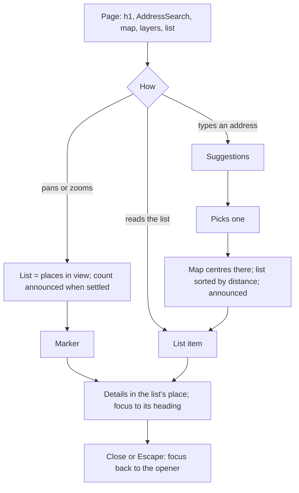

# Design spec: Map and AddressSearch

- **Status:** Draft
- **Designer:** ux-designer agent · **Date:** 2026-10-14
- **Plan:** 0117 (to be written, `docs/design/plans/0117-map.md`)
- **Type:** component default styling + flow (new package `@kvirn-ui/map`, and AddressSearch on Autocomplete)

Decided by the maintainer and not reopened here: our own typed API over `MapProvider` and `GeocoderProvider`, engine adapters as sub-entries with the engine as an optional peer, zero CSS in the package (`kv-map-*` classes in `theme.css`, `data-*` state), **no default tile or geocoder URL** (rule 7, GDPR), and the scope below. Part names are a proposal for the plan.

## 1. Brief

- **Users:** both. Residents find a place (a preschool, a recycling station, a polling station, roadworks) once, on a phone, often stressed. Staff and planners look up places and layers daily on a desktop.
- **Hardest-case users:** (1) a screen-reader user who wants the nearest preschool to their home and will never use the canvas; (2) a keyboard-only user with a tremor at 400% zoom (320 CSS px) who can't drag or pinch; (3) a phone user at 320px whose page scroll gets captured by the map; (4) a Windows Contrast Themes user who must tell markers, the selected one and focus apart on unknown map imagery; (5) a second-language reader in Finnish.
- **Job to be done:** When I need a public place near me, I want to find it by my address or on a map, so I can see what it is, where it is and how to get there.
- **Context:** residents rarely, any device, often touch. Staff daily, desktop, keyboard.
- **Constraints:** rule 7: the consumer configures the tile source and the geocoder, and the docs say so on every page, with what each request reveals (the tiles requested show the area viewed; typed text goes to the geocoder). Tile sources need visible attribution (OSM's licence asks for it). Hard rules 4, 5, 14. WCAG 2.2 AA as far as a map allows; no compliance claim.
- **Success:** a screen-reader user finds the nearest place and its opening hours without the canvas; a keyboard-only user selects a marker and reads its details; nobody gets stuck scrolling past the map at 320px; no task needs a drag or a pinch.
- **Evidence:** none from KvirnUI users. Prior art in §2. Everything else is an assumption.
- **Assumptions → research questions:**
  - The list is found and trusted as "the same places as the map". → Do screen-reader participants use the list without being told?
  - "Places in the map view" is understood. → Do participants grasp why the list changes when they pan?
  - Two-finger panning on touch is acceptable to residents. → Do phone participants pan without help after seeing the hint once?

## 2. Prior art

| Source                                                                                                                                                             | What we reuse                                                                                                             | What we change and why                                                                                        |
| ------------------------------------------------------------------------------------------------------------------------------------------------------------------ | ------------------------------------------------------------------------------------------------------------------------- | ------------------------------------------------------------------------------------------------------------- |
| KvirnUI Autocomplete (`autocomplete.a11y.md`), Fieldset, Checkbox, Card, Alert, Progress, Tooltip, Disclosure, Skip link                                           | AddressSearch is an Autocomplete; layers are a Fieldset of Checkboxes; details are a Card; states are Alerts and Progress | Nothing new where a part exists                                                                               |
| APG: no map pattern. Toolbar (roving `tabindex`), Disclosure (button + `aria-expanded`)                                                                            | The marker set uses the Toolbar's mechanics; a marker and a list item are disclosure buttons for the details              | The viewport's keys and the marker set are a new key table: maintainer approval (§9 D2, D4)                   |
| [Leaflet](https://leafletjs.com/reference.html#map-keyboard) and [MapLibre KeyboardHandler](https://maplibre.org/maplibre-gl-js/docs/API/classes/KeyboardHandler/) | Focusable map, arrows pan, `+`/`=` and `-` zoom                                                                           | No rotate or pitch (MapLibre's Shift+arrows); Leaflet makes every marker a Tab stop, we make the set one stop |
| Defra, [designing a more accessible flood map](https://defradigital.blog.gov.uk/2021/05/20/designing-a-more-accessible-flood-map)                                  | Every pointer action also by keyboard; frameworks only give pan and zoom, the features are the hard part                  | Their numbered-feature keys aren't APG and aren't discoverable: we use a list instead                         |
| WCAG Understanding 2.5.7 (the map example), 1.4.10 (maps as 2D content)                                                                                            | Pan buttons as the single-pointer alternative to dragging; the canvas may scroll in two dimensions                        | The UI around the map still reflows                                                                           |
| GOV.UK "Addresses" pattern; Google Maps `gestureHandling: cooperative`                                                                                             | "I can't find my address" to manual entry; one finger scrolls the page, two move the map                                  | Nordic addresses: an Autocomplete on street and town, no postcode-first lookup                                |

## 3. Flow



Unhappy paths:

| Situation                                    | What the user gets                                                                                                                        |
| -------------------------------------------- | ----------------------------------------------------------------------------------------------------------------------------------------- |
| Map loading                                  | `map.loading` with a spinner at the viewport's block start. The list renders without the map (it is server-renderable)                    |
| Tiles fail / offline                         | `Alert.Warning` (`map.tilesFailed.*`) + Try again, or `Alert.Info` (`map.offline`) in the viewport. Markers and list keep working         |
| No tile source configured                    | Markers on the `surface` background, a dev warning (`map-no-tile-source`). Never a fallback URL                                           |
| No places in view                            | Empty state `map.list.empty` with "Show all places" (fits the view to every visible layer)                                                |
| Every layer hidden                           | Empty state `map.list.noLayers`, with a link to the layers fieldset                                                                       |
| A layer fails                                | Its checkbox gets an error (`map.layers.failed`) and a Try again button; other layers stay                                                |
| Zoom limit reached                           | The button is `aria-disabled` (focus stays) and `map.zoomLimitIn`/`Out` is announced                                                      |
| Locate: denied / unavailable / unsupported   | `map.locate.denied` or `.unavailable` under the controls, pointing to the search. Unsupported or not a secure context: no button          |
| Address: no match / geocoder down / slow     | `addressSearch.noResults` (with the text), `.failed` (type it yourself), `.loading`. Typed text is never cleared                          |
| Selected place clustered or its layer hidden | Details stay open while the place exists; hidden layer closes them, focus stays on the checkbox. A gone opener: focus to the list heading |
| JavaScript off                               | The list (server-rendered) and the address field as a plain input. No map                                                                 |

## 4. Content

Five locales, `map` and `addressSearch` namespaces. `{count}` keys use `format.plural`; `{accuracy}` and distances use `Intl` units. nb and nn are drafts for a native reviewer.

| Key                                       | en                                                                                  | sv                                                                                          | fi (longest)                                                                                 | nb                                                                                        | nn                                                                                         |
| ----------------------------------------- | ----------------------------------------------------------------------------------- | ------------------------------------------------------------------------------------------- | -------------------------------------------------------------------------------------------- | ----------------------------------------------------------------------------------------- | ------------------------------------------------------------------------------------------ |
| `map.roleDescription`                     | map                                                                                 | karta                                                                                       | kartta                                                                                       | kart                                                                                      | kart                                                                                       |
| `map.summary`                             | The map shows {count} places. The same places are in the list.                      | Kartan visar {count} platser. Samma platser finns i listan.                                 | Kartalla on {count} paikkaa. Samat paikat ovat luettelossa.                                  | Kartet viser {count} steder. De samme stedene står i listen.                              | Kartet viser {count} stader. Dei same stadene står i lista.                                |
| `map.keyboardHint`                        | Move the map with the arrow keys. Zoom with + and −.                                | Flytta kartan med piltangenterna. Zooma med + och −.                                        | Siirrä karttaa nuolinäppäimillä. Lähennä ja loitonna näppäimillä + ja −.                     | Flytt kartet med piltastene. Zoom med + og −.                                             | Flytt kartet med piltastane. Zoom med + og −.                                              |
| `map.skipToList`                          | Skip the map, go to the list of places                                              | Hoppa förbi kartan till listan med platser                                                  | Ohita kartta ja siirry paikkaluetteloon                                                      | Hopp over kartet til listen over steder                                                   | Hopp over kartet til lista over stader                                                     |
| `map.controlsLabel`                       | Map controls                                                                        | Kartverktyg                                                                                 | Kartan työkalut                                                                              | Kartverktøy                                                                               | Kartverktøy                                                                                |
| `map.markersLabel`                        | Places in the map view                                                              | Platser i kartvyn                                                                           | Paikat kartta-alueella                                                                       | Steder i kartutsnittet                                                                    | Stader i kartutsnittet                                                                     |
| `map.zoomIn` / `map.zoomOut`              | Zoom in / Zoom out                                                                  | Zooma in / Zooma ut                                                                         | Lähennä / Loitonna                                                                           | Zoom inn / Zoom ut                                                                        | Zoom inn / Zoom ut                                                                         |
| `map.zoomLimitIn` / `Out`                 | You can't zoom in (out) any further                                                 | Du kan inte zooma in (ut) mer                                                               | Karttaa ei voi lähentää (loitontaa) enempää                                                  | Du kan ikke zoome inn (ut) mer                                                            | Du kan ikkje zoome inn (ut) meir                                                           |
| `map.reset`                               | Whole map                                                                           | Hela kartan                                                                                 | Koko kartta                                                                                  | Hele kartet                                                                               | Heile kartet                                                                               |
| `map.pan.north` (`south`, `east`, `west`) | Move the map north                                                                  | Flytta kartan norrut (söderut, österut, västerut)                                           | Siirrä karttaa pohjoiseen (etelään, itään, länteen)                                          | Flytt kartet nordover (sørover, østover, vestover)                                        | Flytt kartet nordover (sørover, austover, vestover)                                        |
| `map.cluster`                             | {count} places. Zoom in to see them                                                 | {count} platser. Zooma in för att se dem                                                    | {count} paikkaa. Lähennä nähdäksesi ne                                                       | {count} steder. Zoom inn for å se dem                                                     | {count} stader. Zoom inn for å sjå dei                                                     |
| `map.placesInView`                        | {count} places in the map view                                                      | {count} platser i kartvyn                                                                   | {count} paikkaa kartta-alueella                                                              | {count} steder i kartutsnittet                                                            | {count} stader i kartutsnittet                                                             |
| `map.placesAll`                           | {count} places                                                                      | {count} platser                                                                             | {count} paikkaa                                                                              | {count} steder                                                                            | {count} stader                                                                             |
| `map.loading`                             | Loading the map                                                                     | Laddar kartan                                                                               | Karttaa ladataan                                                                             | Laster inn kartet                                                                         | Lastar inn kartet                                                                          |
| `map.tilesFailed.title`                   | The map can't be shown right now                                                    | Kartan kan inte visas just nu                                                               | Karttaa ei voi näyttää juuri nyt                                                             | Kartet kan ikke vises akkurat nå                                                          | Kartet kan ikkje visast akkurat no                                                         |
| `map.tilesFailed.body`                    | You can still find every place in the list.                                         | Du hittar ändå alla platser i listan.                                                       | Löydät silti kaikki paikat luettelosta.                                                      | Du finner likevel alle stedene i listen.                                                  | Du finn likevel alle stadene i lista.                                                      |
| `map.retry`                               | Try again                                                                           | Försök igen                                                                                 | Yritä uudelleen                                                                              | Prøv igjen                                                                                | Prøv igjen                                                                                 |
| `map.offline`                             | You're offline. The map shows only what has already loaded.                         | Du är offline. Kartan visar bara det som redan har laddats.                                 | Olet offline-tilassa. Kartta näyttää vain sen, mikä on jo ladattu.                           | Du er frakoblet. Kartet viser bare det som allerede er lastet inn.                        | Du er fråkopla. Kartet viser berre det som alt er lasta inn.                               |
| `map.gestureTouch`                        | Use two fingers to move the map                                                     | Använd två fingrar för att flytta kartan                                                    | Siirrä karttaa kahdella sormella                                                             | Bruk to fingre for å flytte kartet                                                        | Bruk to fingrar for å flytte kartet                                                        |
| `map.gestureWheel` ({modifier})           | Hold {modifier} and scroll to zoom the map                                          | Håll ned {modifier} och scrolla för att zooma kartan                                        | Lähennä tai loitonna karttaa pitämällä {modifier}-näppäintä pohjassa ja vierittämällä        | Hold nede {modifier} og rull for å zoome kartet                                           | Hald nede {modifier} og rull for å zoome kartet                                            |
| `map.locate`                              | My location                                                                         | Min plats                                                                                   | Oma sijainti                                                                                 | Min posisjon                                                                              | Min posisjon                                                                               |
| `map.locate.notice`                       | Your browser asks before it shares your location with this page.                    | Webbläsaren frågar innan den delar din position med sidan.                                  | Selain kysyy lupaa ennen kuin se jakaa sijaintisi tälle sivulle.                             | Nettleseren spør før den deler posisjonen din med siden.                                  | Nettlesaren spør før han deler posisjonen din med sida.                                    |
| `map.locate.finding`                      | Finding your location                                                               | Söker din position                                                                          | Sijaintiasi haetaan                                                                          | Finner posisjonen din                                                                     | Finn posisjonen din                                                                        |
| `map.locate.found` ({accuracy})           | The map shows your location, accurate to about {accuracy}.                          | Kartan visar din position, med en noggrannhet på cirka {accuracy}.                          | Kartalla näkyy sijaintisi noin {accuracy}:n tarkkuudella.                                    | Kartet viser posisjonen din, nøyaktig til omtrent {accuracy}.                             | Kartet viser posisjonen din, nøyaktig til omtrent {accuracy}.                              |
| `map.locate.denied`                       | You haven't let this page use your location. You can search for an address instead. | Du har inte gett sidan tillgång till din position. Du kan söka på en adress i stället.      | Et ole antanut sivulle lupaa käyttää sijaintiasi. Voit hakea osoitteella sen sijaan.         | Du har ikke gitt siden tilgang til posisjonen din. Du kan søke etter en adresse i stedet. | Du har ikkje gitt sida tilgang til posisjonen din. Du kan søkje etter ei adresse i staden. |
| `map.locate.unavailable`                  | We couldn't find your location. Try again, or search for an address.                | Vi kunde inte hitta din position. Försök igen eller sök på en adress.                       | Sijaintiasi ei löytynyt. Yritä uudelleen tai hae osoitteella.                                | Vi fant ikke posisjonen din. Prøv igjen, eller søk etter en adresse.                      | Vi fann ikkje posisjonen din. Prøv igjen, eller søk etter ei adresse.                      |
| `map.youAreHere`                          | You are here                                                                        | Du är här                                                                                   | Olet tässä                                                                                   | Du er her                                                                                 | Du er her                                                                                  |
| `map.details.close`                       | Close                                                                               | Stäng                                                                                       | Sulje                                                                                        | Lukk                                                                                      | Lukk                                                                                       |
| `map.list.onlyInView`                     | Show only places in the map view                                                    | Visa bara platser i kartvyn                                                                 | Näytä vain kartta-alueen paikat                                                              | Vis bare steder i kartutsnittet                                                           | Vis berre stader i kartutsnittet                                                           |
| `map.list.sortedByDistance` ({address})   | Nearest to {address} first                                                          | Närmast {address} först                                                                     | Lähimmät ensin osoitteesta {address}                                                         | Nærmest {address} først                                                                   | Nærast {address} først                                                                     |
| `map.list.empty`                          | There are no places in the map view. Zoom out or move the map.                      | Det finns inga platser i kartvyn. Zooma ut eller flytta kartan.                             | Kartta-alueella ei ole paikkoja. Loitonna tai siirrä karttaa.                                | Det er ingen steder i kartutsnittet. Zoom ut eller flytt kartet.                          | Det er ingen stader i kartutsnittet. Zoom ut eller flytt kartet.                           |
| `map.list.showAll`                        | Show all places                                                                     | Visa alla platser                                                                           | Näytä kaikki paikat                                                                          | Vis alle steder                                                                           | Vis alle stader                                                                            |
| `map.list.noLayers`                       | Nothing is shown. Choose what the map shows.                                        | Inget visas. Välj vad kartan ska visa.                                                      | Mitään ei näytetä. Valitse, mitä kartalla näytetään.                                         | Ingenting vises. Velg hva kartet skal vise.                                               | Ingenting blir vist. Vel kva kartet skal vise.                                             |
| `map.layers.legend`                       | Show on the map                                                                     | Visa på kartan                                                                              | Näytä kartalla                                                                               | Vis på kartet                                                                             | Vis på kartet                                                                              |
| `map.layers.toggle` ({shown}, {total})    | Show on the map ({shown} of {total})                                                | Visa på kartan ({shown} av {total})                                                         | Näytä kartalla ({shown}/{total})                                                             | Vis på kartet ({shown} av {total})                                                        | Vis på kartet ({shown} av {total})                                                         |
| `map.layers.failed` ({layer})             | {layer} couldn't be loaded.                                                         | {layer} kunde inte laddas.                                                                  | Tasoa {layer} ei voitu ladata.                                                               | {layer} kunne ikke lastes inn.                                                            | {layer} kunne ikkje lastast inn.                                                           |
| `map.attributionLabel`                    | Map data                                                                            | Kartdata                                                                                    | Karttatiedot                                                                                 | Kartdata                                                                                  | Kartdata                                                                                   |
| `addressSearch.label`                     | Search for an address                                                               | Sök adress                                                                                  | Hae osoitetta                                                                                | Søk etter adresse                                                                         | Søk etter adresse                                                                          |
| `addressSearch.helpText`                  | Type the street address and town. Then choose an address in the list.               | Skriv gatuadress och ort. Välj sedan en adress i listan.                                    | Kirjoita katuosoite ja paikkakunta. Valitse sitten osoite luettelosta.                       | Skriv gateadresse og sted. Velg så en adresse i listen.                                   | Skriv gateadresse og stad. Vel så ei adresse i lista.                                      |
| `addressSearch.submit`                    | Search                                                                              | Sök                                                                                         | Hae                                                                                          | Søk                                                                                       | Søk                                                                                        |
| `addressSearch.resultCount`               | {count} addresses                                                                   | {count} adresser                                                                            | {count} osoitetta                                                                            | {count} adresser                                                                          | {count} adresser                                                                           |
| `addressSearch.loading`                   | Searching for addresses                                                             | Söker adresser                                                                              | Haetaan osoitteita                                                                           | Søker etter adresser                                                                      | Søkjer etter adresser                                                                      |
| `addressSearch.noResults` ({text})        | We found no address matching "{text}". Check the spelling, or add the town.         | Vi hittade ingen adress som matchar ”{text}”. Kontrollera stavningen eller lägg till orten. | Hakua ”{text}” vastaavaa osoitetta ei löytynyt. Tarkista kirjoitusasu tai lisää paikkakunta. | Vi fant ingen adresse som passer med «{text}». Sjekk stavemåten, eller legg til stedet.   | Vi fann inga adresse som passar med «{text}». Sjekk stavemåten, eller legg til staden.     |
| `addressSearch.failed`                    | Address search isn't working right now. You can type the address yourself.          | Adressökningen fungerar inte just nu. Du kan skriva adressen själv.                         | Osoitehaku ei toimi juuri nyt. Voit kirjoittaa osoitteen itse.                               | Adressesøket virker ikke akkurat nå. Du kan skrive adressen selv.                         | Adressesøket verkar ikkje akkurat no. Du kan skrive adressa sjølv.                         |
| `addressSearch.shownOnMap` ({address})    | The map shows {address}.                                                            | Kartan visar {address}.                                                                     | Kartalla näkyy {address}.                                                                    | Kartet viser {address}.                                                                   | Kartet viser {address}.                                                                    |
| `addressSearch.filled`                    | The address has been filled in below. Check that it's right.                        | Adressen är ifylld nedan. Kontrollera att den stämmer.                                      | Osoite on täytetty alle. Tarkista, että se on oikein.                                        | Adressen er fylt ut nedenfor. Sjekk at den stemmer.                                       | Adressa er fylt ut nedanfor. Sjekk at ho stemmer.                                          |
| `addressSearch.manual`                    | I can't find my address                                                             | Jag hittar inte min adress                                                                  | En löydä osoitettani                                                                         | Jeg finner ikke adressen min                                                              | Eg finn ikkje adressa mi                                                                   |

Consumer content, not keys: the map's name (`label`, "Karta över förskolor"), layer names and descriptions, place data, details content, attribution text (the source's licence), the page heading.

## 5. Structure

One DOM order at every width; no grid reordering. Landmarks are the page's; the map adds a named `region` (the viewport) and nothing else.

```
h1 Hitta förskola
AddressSearch          label · help text · [input ×] [Sök] · error · "Jag hittar inte min adress"
Map.Root
  Skip link            "Hoppa förbi kartan…" (visible on focus) → the list heading
  Viewport (region)    tiles · markers set · hint · status · (≥40rem: controls, pan, attribution overlaid)
  Controls row         (<40rem only: zoom −/+, Hela kartan, Min plats, pan cross, attribution, in flow)
Side
  Layers               ≥64rem: Fieldset "Visa på kartan"; <64rem: inside a Disclosure (map.layers.toggle)
  List | Details       h2 "12 platser i kartvyn" · [☑ Visa bara platser i kartvyn] · sort line · ul
                       — or, while a place is selected, the details Card in the same slot
```

| Width       | Layout                                                                                                                                                                      |
| ----------- | --------------------------------------------------------------------------------------------------------------------------------------------------------------------------- |
| < 40rem     | One column. Viewport full width, `--kv-map-block-size`. Controls in a wrapping row under it. Layers in a Disclosure. Details are the anchored popup at every width (§9 D13) |
| 40rem–64rem | One column. Controls, pan and attribution overlay the viewport at its inline end. Layers still a Disclosure                                                                 |
| ≥ 64rem     | `kv-grid--lg-cols-12`: map `lg-span-8` at inline start, side `lg-span-4` at inline end (map first in DOM and on screen). AddressSearch above both, in the 40rem form column |

## 6. Visual specification

| Part (class)                                 | Tokens / metrics                                                                                                                                                                                                                                               | Notes                                                                                       |
| -------------------------------------------- | -------------------------------------------------------------------------------------------------------------------------------------------------------------------------------------------------------------------------------------------------------------- | ------------------------------------------------------------------------------------------- |
| Viewport `kv-map-viewport`                   | `surface` under the tiles, 1px `border-control`, `--kv-radius-lg`, block size `--kv-map-block-size` (proposed, §6.4). Ring 2px `focus-ring` outside at `--kv-focus-ring-offset`                                                                                | Its parent must not clip the ring. `kv-map--flush`: no edge, no radius, the halo ring inset |
| Halo (rule, §9 D6)                           | Anything drawn on imagery has a light and a dark edge: 2px `canvas` then 1px `text` (they swap per theme, so one is always light, one dark)                                                                                                                    | Imagery can't be measured: the pair guarantees an edge of at least 3:1 against any colour   |
| Marker `kv-map-marker` (a `<button>`)        | Hit area `--kv-control-min-block-size` square (44px, 32px compact, never under 24px). Drawn: a 24px `radius-full` circle, `primary` fill, the halo; the consumer's 16px icon in `on-primary` as children                                                       | Centre on the coordinate. A layer's look is the consumer's class and icon, never a prop     |
| Marker hover · focus-visible                 | Hover: `primary-hover` fill and a Tooltip with the name (`body`, level 3). Focus: 2px `focus-ring` at the offset, the offset gap filled `canvas`                                                                                                               | Tooltip per DESIGN.md Overlays; never holds more than the name                              |
| Marker selected `[aria-expanded=true]`       | 32px circle, `primary-hover` fill, an extra 2px `text` ring outside the halo, drawn above the others                                                                                                                                                           | Size + ring + the open details: never colour alone                                          |
| Marker highlighted `[data-highlighted]`      | The extra 2px `text` ring, no size change (its list item is hovered or focused)                                                                                                                                                                                | Not announced                                                                               |
| Cluster `kv-map-cluster`                     | `radius-full`, min 44px (32px compact), `surface-raised` fill, 2px `text` edge + 2px `canvas` halo, count in `label` weight 500 with tabular figures in `text`, `space-2` inline padding as digits grow                                                        | Shape and number differ from a place marker                                                 |
| Searched address `kv-map-search-result`      | A 24px `text` ring (4px) with a `canvas` centre and halo: a target, not a place                                                                                                                                                                                | `aria-hidden`; the announcement and the sort line carry it                                  |
| You are here `kv-map-location`               | 16px `primary` dot with the halo; accuracy as a 1px dashed `primary` circle, no fill. Never pulses (2.2.2)                                                                                                                                                     | `aria-hidden`; `map.locate.found` carries it                                                |
| Hint `kv-map-hint`                           | Level 3 plate: `surface-raised`, 1px `border-subtle`, `--kv-shadow-popup`, `md` radius, `space-2` by `space-3`, `body` in `text`, at most 20rem; `space-2` from the viewport's block-start inline-start                                                        | Keyboard hint and gesture hints. Wraps; never truncated                                     |
| Controls `kv-map-controls`, pan `kv-map-pan` | `kv-button` (depth kept: they are buttons). ≥40rem a column `space-2` apart at inline-end block-start, `space-2` inset, on a `surface-raised` plate with `border-subtle` and `md` radius; pan a 3×3 cross at block-end                                         | Zoom and pan `kv-button--icon-only` + Tooltip (§9 D5); Reset and Locate show their words    |
| Status `kv-map-status`                       | `Alert.Warning`/`Alert.Info` or `kv-progress` + `kv-spinner`, at the viewport's block start, `space-4` inset, at most 40rem, start-aligned                                                                                                                     | Never centred (DESIGN.md Progress and empty state)                                          |
| Attribution `kv-map-attribution`             | `body-small` in `text` on a `surface-raised` plate, `sm` radius, `space-1` by `space-2`, links `kv-link` ≥24px. ≥40rem at block-end inline-start; <40rem in the controls row                                                                                   | The consumer's licence text. Named by `map.attributionLabel`                                |
| Layers                                       | `Fieldset.Root` + `Checkbox` per layer; a 20px decorative swatch (the layer's marker icon) before the label; layer description as `Field.HelpText`; errors as `Field.ErrorMessage` + `kv-button` Try again                                                     | Two layers never differ by colour alone: icon + name                                        |
| List `kv-map-list` (`ul role="list"`)        | Rows like the Definition list: `border-subtle` under each, `space-3` block padding. Trigger `kv-map-list-trigger`: the Accordion trigger look (whole row, weight 600, underline on hover), no chevron; then address and distance (`numeric`) in `body`, `text` | `[data-highlighted]` (its marker hovered): `primary-subtle` fill and the trigger underlined |
| Details `kv-map-details`                     | A `Card` (level 2, `lg`): header with the title (`heading-3` look, level via `as`) and the Close icon button at inline end; body and footer are the consumer's                                                                                                 | Same slot as the list at every width                                                        |

### States

| Part     | default            | hover                | focus-visible           | active          | disabled                                                 | loading                                           | selected / open           | empty                              |
| -------- | ------------------ | -------------------- | ----------------------- | --------------- | -------------------------------------------------------- | ------------------------------------------------- | ------------------------- | ---------------------------------- |
| Viewport | tiles on `surface` | gesture hint (wheel) | ring + keyboard hint    | n/a             | n/a                                                      | `map.loading`                                     | n/a                       | `surface`, status Alert            |
| Marker   | circle + halo      | `primary-hover`, tip | ring, `canvas` gap, tip | `primary-hover` | n/a                                                      | n/a                                               | 32px + `text` ring        | set not rendered                   |
| Control  | `kv-button`        | `kv-button`          | ring                    | pressed         | `aria-disabled` at a zoom limit: dashed edge, focus kept | Locate: busy (`data-busy`) + `map.locate.finding` | n/a                       | Locate not rendered if unsupported |
| Layer    | checkbox           | checkbox             | checkbox                | n/a             | n/a                                                      | help text `Laddar`                                | checked: shown            | error + Try again                  |
| List row | trigger + facts    | underline            | ring                    | n/a             | n/a                                                      | `kv-progress`                                     | hidden while details open | `kv-empty-state`                   |

### Modes

- **Dark and contrast themes:** the UI follows the theme; tiles are the source's (a consumer may give a dark style). The halo uses `canvas` and `text`, which swap, so it holds on any imagery.
- **Forced colours:** markers `forced-color-adjust: none` with `Canvas` fill, 2px `CanvasText` edge, icon `CanvasText`; selected `Highlight` fill, `HighlightText` icon, 2px `CanvasText` ring; focus 2px `Highlight` ring with a `Canvas` gap; cluster `Canvas`/`CanvasText`; plates `Canvas` with a `CanvasText` edge; viewport edge `CanvasText`. Imagery is not adjusted by the browser, which is why every mark carries both system colours.
- **RTL:** the page mirrors (overlays at inline end move left; side panel left). The map never mirrors: north is up and east is right. Pan arrows and their icons don't flip; zoom marks don't. The marker set's next/previous arrows do flip (§7).
- **Motion:** pan and zoom animate only under `no-preference` and without `data-kv-motion="reduce"`, at most `--kv-duration-slow`, otherwise the view jumps (§9 D7). No bounce, pulse or fly-over. Hints appear and go without a fade.
- **320px, 400%, 1.4.12:** the map is 2D content (1.4.10 exception) but nothing around it scrolls sideways; controls move under the viewport; one finger scrolls the page (§9 D9); hints and attribution wrap; no fixed heights on text.

### New or changed tokens

No new colour and no new colour pair. Proposed for the maintainer: `--kv-map-block-size` (a site default custom property, like `--kv-popup-height-limit`), default `clamp(15rem, 60vh, 40rem)`. Rules for DESIGN.md (§9 D5–D7): the halo, map-view motion, and icon-only zoom and pan buttons. New built-in icons needed: `remove` (minus), `arrow-up`, `arrow-down`, `locate`.

## 7. Accessibility annotations

**Names and roles.** Viewport: `div role="region" tabindex="0"`, `aria-label` = the consumer's `label`, `aria-roledescription` = `map.roleDescription`, `aria-describedby` = `map.summary` + `map.keyboardHint` (visually hidden until focus). Marker set: `role="group"` named `map.markersLabel`. Marker: `<button>` named by the place's name, `aria-expanded` + `aria-controls` → details. Cluster: `<button>` named `map.cluster` (visible "14" starts the name, 2.5.3). Controls: `role="group"` named `map.controlsLabel`, native buttons. Layers: `fieldset`/`legend`. List: `h2` + `ul role="list"`, each row's trigger a `<button aria-expanded aria-controls>`. Details: `<section aria-labelledby=title>`; Close named "Stäng" + title (`aria-labelledby`, as combobox m2).

**Tab order** (DOM = visual): AddressSearch input → Sök → "Jag hittar inte min adress" → skip link → viewport → marker set (1 stop, if any in view) → zoom in → zoom out → Hela kartan → Min plats → pan N, W, E, S → attribution links → layers (trigger or checkboxes) → list: "Visa bara…" → each row trigger; or, when open, the details' Close and content.

**Keys** (no APG map pattern: the whole table needs approval, §9 D2, D4):

| Part            | Key                                 | Action                                                                                                                                                                            |
| --------------- | ----------------------------------- | --------------------------------------------------------------------------------------------------------------------------------------------------------------------------------- |
| Viewport        | Arrows                              | Pan a quarter of the viewport's shorter side. Spatial, so never flipped in RTL                                                                                                    |
| Viewport        | `+` / `=`, `-` (and numpad)         | Zoom in, zoom out. Only while the viewport has focus, so 2.1.4 doesn't apply. With Control/Command never taken (browser zoom, 1.4.4)                                              |
| Viewport        | Escape                              | Hides the keyboard hint (1.4.13); otherwise the page's                                                                                                                            |
| Marker set      | Tab                                 | Enters at the selected marker, else the first in list order. Leaves on the next Tab                                                                                               |
| Marker set      | ArrowRight/Down, ArrowLeft/Up       | Next / previous marker in list order, wraps (Toolbar). Left and Right flip in RTL. Focus pans the map only if the marker is under an overlay (2.4.11)                             |
| Marker set      | Home / End                          | First / last marker                                                                                                                                                               |
| List (over 50)  | Tab                                 | One stop: the last focused or opened row, else the first rendered. The next Tab leaves the list (Plan 0119)                                                                       |
| List (over 50)  | ArrowDown/Up, Home/End, PageDown/Up | Next / previous row, first / last, a page of rows; the row is rendered, then focused. No wrap, not flipped in RTL. Lists of 50 or fewer have a stop per row and no keys           |
| Marker          | Enter / Space                       | Opens its details; focus to the details heading (`tabindex="-1"`, §9 D3)                                                                                                          |
| Cluster         | Enter / Space                       | Opens the cluster popup (it does not zoom: zoom stays on `+` and the controls); focus to its title. Escape and Close return focus to the cluster; a place in it opens its details |
| Details         | Escape (focus inside), Close        | Closes; focus back to the opener (marker or list row), else the list heading. Never `body`                                                                                        |
| Everything else | native                              | Buttons, checkboxes, the Autocomplete's own table (`autocomplete.a11y.md`)                                                                                                        |

**Pointer.** Drag pans; one finger scrolls the page on touch and two fingers pan; the wheel scrolls the page and zooms with Control/Command (§9 D9), with `map.gestureTouch`/`map.gestureWheel` in a hint that stays until the next interaction (no timer). Pinch and double-tap zoom. No rotate or pitch. Every gesture has a single-pointer button (2.5.1, 2.5.7).

**AddressSearch without a map.** It is an Autocomplete with `filter={false}`, the geocoder's results as `items`, `isLoading`, and a debounce with a minimum of 3 characters (the defaults, overridable; fewer requests to the geocoder). Its value is the text plus `result` (the picked address, else `null`); the text is never cleared (§9 D12).

- Standalone (`<search>` + form + Sök): Enter with no active suggestion submits; the geocoder runs on the text. One result: chosen and announced. Several: the popup opens with them and `addressSearch.resultCount` is announced; nothing is active. None: an error under the field (`addressSearch.noResults`), announced, focus stays.
- In a form: Enter is the form's (Autocomplete rule). Picking fills the consumer's `AddressInput` fields (3.3.7), which stay editable, and announces `addressSearch.filled`. "Jag hittar inte min adress" opens the manual fields.
- With a map: picking centres the map (focus stays in the input, 3.2.2), shows the target mark, sorts the list by distance, and announces `addressSearch.shownOnMap`. The list is then the screen-reader user's "near me" answer.

**Announcements** (the shared Announcer, polite, about 500 ms after the view settles; never during a drag):

| Event                                                  | Key                                                                                                      |
| ------------------------------------------------------ | -------------------------------------------------------------------------------------------------------- |
| View changed by a key, button, cluster or layer change | `map.placesInView` (or `map.placesAll`), only when the count changed or the user pressed a key or button |
| Zoom limit                                             | `map.zoomLimitIn` / `Out`                                                                                |
| Tiles failed, offline (once per episode)               | `map.tilesFailed.title`, `map.offline`                                                                   |
| Locate                                                 | `map.locate.finding`, `.found`, `.denied`, `.unavailable`                                                |
| Address search                                         | `addressSearch.loading`, `.resultCount`, `.noResults`, `.failed`, `.shownOnMap`, `.filled`               |
| Not announced                                          | Map loaded, hover, highlight, details opened (focus is the announcement)                                 |

**WCAG SCs of note:** 1.1.1 (summary + list), 1.3.1, 1.3.2, 1.4.1 (shape and words), 1.4.10 (2D exception, UI reflows), 1.4.11 (halo), 1.4.13 (hints dismissible, persistent), 2.1.1, 2.1.2, 2.1.4, 2.4.3, 2.4.7, 2.4.11 (overlays never cover a focused marker; nothing sticky), 2.5.1, 2.5.3, 2.5.7 (pan buttons), 2.5.8 (24px minimum; markers that crowd closer fall under the "equivalent" exception through the list rows, and clustering keeps them apart), 3.2.1, 3.2.2, 3.3.1–3.3.3, 3.3.7, 4.1.2, 4.1.3. Raster tile labels are images of text that don't follow text size (1.4.4, 1.4.5): the consumer's source; the docs advise vector tiles.

## 8. Validation

- [x] Self-review against `review-checklist.md`: every string has a key in five locales; no colour-only state; 44px targets (24px floor); no compliance claim. Open: D2, D4, D5 (rule-level approvals).
- [ ] Contrast: no new colour pair. The halo is a rule on measured tokens; imagery can't be measured.
- [x] Usability test plan written. Result: `pending`. AT testing: `pending`.

**Usability test plan.** Participants (8): NVDA and VoiceOver iOS users, a magnifier user at 400%, a Contrast Themes user, a person with a tremor (keyboard or switch), an older resident with low digital confidence on a phone, a Finnish second-language reader, a staff user. Tasks: (1) find the preschool nearest your home address and its opening hours; (2) do it without the map (screen-reader users); (3) on a phone, scroll past the map to the footer, then zoom into the town centre; (4) show only recycling stations; (5) use My location, then deny it, then recover; (6) select a marker by keyboard only and close its details. Measure: completion, errors, time, whether the list is found unprompted, whether the page scroll gets stuck, whether the zoom limit and counts are heard once.

## 9. Open questions (maintainer decisions)

1. **D1. Viewport role.** `region` + `aria-roledescription` (recommended: content stays readable in browse mode; the list is the screen-reader path) or `application` (arrows reach the map under a screen reader, but it hides structure and is a known trap).
2. **D2. Marker keyboard.** One Tab stop with roving focus in list order (recommended) · every marker a Tab stop (Leaflet; dozens of stops) · no keyboard on markers, the list only (simplest, but a sighted keyboard user can't pick what they see). APG has no map pattern: needs approval and a `keyboard` key-table entry.
3. **D3. Focus on opening details.** To the details heading (recommended: the panel isn't next in the Tab order at any width) or stay on the opener (pure Disclosure).
4. **D4. Viewport keys.** Arrows pan unflipped, `+`/`=`/`-` zoom, Escape hides the hint, nothing else (no rotate, pitch, Home or PageUp). A new key table.
5. **D5. Icon-only zoom and pan buttons**, beyond DESIGN.md's close, search and copy, each with a name and a Tooltip; and the four new icons, in the built-in set or registered by `@kvirn-ui/map`.
6. **D6. The halo rule** for marks on imagery (`canvas` + `text`, and the `canvas` gap in the focus ring) as DESIGN.md text.
7. **D7. Map-view motion** as a new motion category (DESIGN.md Motion lists what moves; a view pan is a transform).
8. **D8. `--kv-map-block-size`** and its default.
9. **D9. Cooperative gestures on by default.** It stops scroll capture at 320px and 400%, at the cost of two-finger panning (2.5.1 covered by the pan buttons). Opt-out for full-screen staff maps.
10. **D10. Pan buttons in the default composition** (recommended, 2.5.7) or opt-in with a documented consumer duty.
11. **D11. List scope.** "Only places in the map view" checked by default (recommended: an address search then gives a near-me list) or all places.
12. **D12. AddressSearch on Autocomplete** (free text, `result` null until picked; recommended) or Combobox (only a found address is valid), and the standalone submit behaviour above.
13. **D13. Details are an anchored popup at every width** (decided by the maintainer, 2026-10-14, replacing the recommended in-flow panel below 40rem). It is a non-modal dialog placed above its marker (below when there is no room), the marker moves to the bottom-centre on press, and the popup scrolls inside the room it has so it never covers the marker (2.4.11). Accepted trade-off: on a 320px map the popup uses most of the map. A floating bottom sheet stays ruled out (sticky, covers the marker, needs a drag alternative, 2.5.7).

**Further questions:** a base-map switcher (a radio group) in this plan or later; paging or a cap for long lists; where the provider's attribution text and its required wording live; default debounce (300 ms?) and minimum length; distance units and rounding per locale.

**Later (not in plan 0117):** drawing, measuring, routing and directions, rotation and 3D, continuous location tracking, offline tile caching, heatmaps, feature editing, print and static map images, a self-built provider.

Sources: [Defra, designing a more accessible flood map](https://defradigital.blog.gov.uk/2021/05/20/designing-a-more-accessible-flood-map), [MapLibre KeyboardHandler](https://maplibre.org/maplibre-gl-js/docs/API/classes/KeyboardHandler/), [Leaflet reference: keyboard](https://leafletjs.com/reference.html#map-keyboard).
