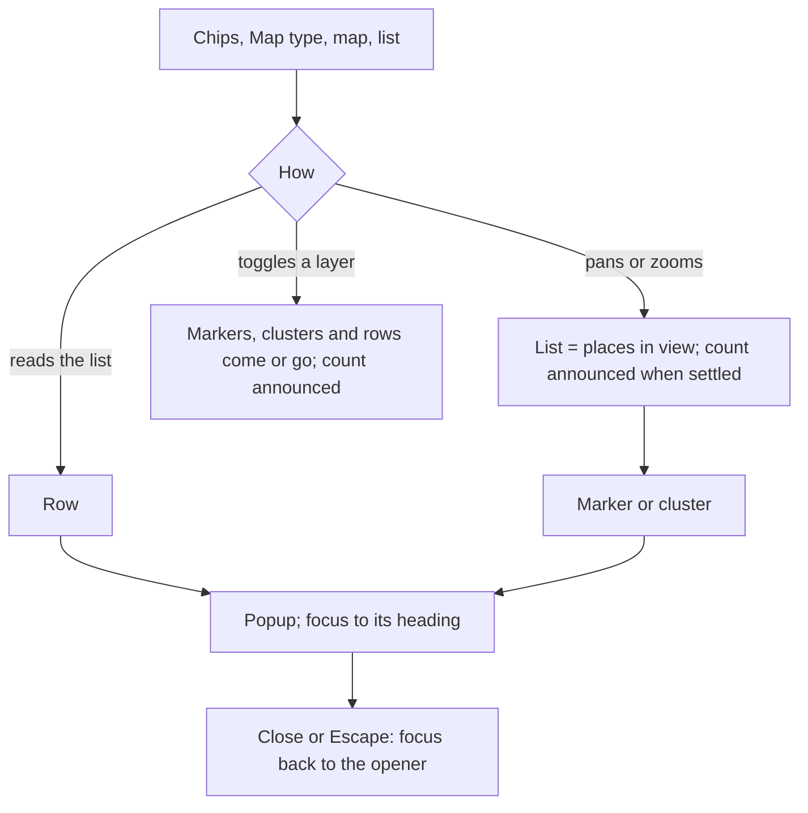

# Design spec: Map

- **Status:** Accepted
- **Plan:** [0117](plans/0117-map-and-address-search.md), [0118](plans/0118-map-layers-and-clusters.md), [0119](plans/0119-map-performance.md), [0120](plans/0120-map-chrome.md)
- **Type:** component default styling and flow (`@kvirn-ui/map`; CSS in `@kvirn-ui/theme/map.css`)
- **Contract:** [map.a11y.md](../../packages/map/src/map.a11y.md). API: [map.md](../../packages/map/src/map.md). The code is the truth; this file describes what ships.

The package draws with a provider the consumer chooses, ships no tile or geocoder URL (rule 7) and no CSS (rule 5). `map.css` holds the default look of the parts the library renders and the documented override hooks, nothing else. Examples of custom markers, layer colours and popups live in Storybook.

## 1. Users and flow

- **Residents** find a place (preschool, recycling station, polling station) once, often on a phone and stressed. **Staff** look places up daily on a desktop, with the keyboard.
- **Hardest cases:** a screen-reader user who never uses the canvas; a keyboard-only user with a tremor at 400% zoom who cannot drag; a phone user at 320px whose page scroll the map must not capture; a forced-colours user who must tell markers, the selected one and focus apart on any imagery; a second-language reader.
- **Job:** find a public place, see what it is and where it is.

| Situation         | What the user gets                                                                                 |
| ----------------- | -------------------------------------------------------------------------------------------------- |
| Loading           | `map.loading` with a spinner in the viewport; the list renders without the map                     |
| Tiles fail        | `map.tilesFailedTitle` and `Body` in the viewport; markers and list keep working                   |
| No places in view | `map.listEmpty`                                                                                    |
| Zoom limit        | The button is `aria-disabled` (focus stays) and `map.zoomLimitIn` or `Out` is announced            |
| Large source      | `map.indexing` is announced once while the index builds; markers appear when it is done            |
| A layer is hidden | Its markers, clusters and rows go; an open popup of its places closes; focus stays on the checkbox |

## 2. Layout

The root is a container (`container-type: inline-size`), so a map in a narrow column behaves like a phone. The breakpoint is **40rem of the map's own width**, not the page's.

| Width    | Layout                                                                                                                                                                                                                                                                                                                                        |
| -------- | --------------------------------------------------------------------------------------------------------------------------------------------------------------------------------------------------------------------------------------------------------------------------------------------------------------------------------------------- |
| >= 40rem | The chrome floats on the canvas, `space-2` from the edge: Layers top inline start, Map type bottom inline start, Controls top inline end, Attribution bottom inline end. The keyboard hint sits at the bottom centre, clear of the Layers card. The list is under the map.                                                                    |
| < 40rem  | A grid: Layers row, Map type row, the map (`--kv-map-block-size`, default `clamp(15rem, 60vh, 40rem)`), the Controls as a wrapping row of buttons, the Attribution row. Nothing clips at 320px or 400% zoom, and the buttons stay the single-pointer alternative to two-finger pan (2.5.7). Markers, popup, hint and status keep the map row. |

Every floating part is a `Map.Overlay` (Layers, Map type, Controls and Attribution register themselves), so a marker reached by keyboard is panned clear of it (2.4.11). The map never mirrors: north is up, east is right, so positions over the canvas are physical. Chrome at the inline end follows the page's direction.

## 3. Parts

All floating surfaces share one recipe: `surface-raised`, 1px `border-subtle`, `radius-md`, `--kv-shadow-popup` (none in dark and contrast themes, where the lighter surface carries it). Text and edges on it are measured pairs in `theme:check`.

### Layers (Show on the map)

A card of stacked chips, one native checkbox each (visually clipped, still focusable; the label is the chip). The legend (`map.layersLegend`) is the card's title.

| State         | Look                                                                                                                                                                                                        |
| ------------- | ----------------------------------------------------------------------------------------------------------------------------------------------------------------------------------------------------------- |
| Layout        | `[state 1rem] [swatch 1.5rem] [name] [count]`, gap `space-2`, `min-block-size` 44px, `radius-md`, 1px `border-control`, name `label` type. The state slot is always there, so toggling never resizes a chip |
| Unchecked     | `surface-raised`, a **plus** in `text-muted`; swatch on `surface` with a `border-control` edge                                                                                                              |
| Checked       | `primary` fill and edge, `on-primary` text, a **check**; swatch inverted; the count after a 1px divider. Plus versus check is the shape cue (1.4.1)                                                         |
| Hover, active | Unchecked `primary-subtle`; checked `primary-hover` (darker, never lighter). No depth                                                                                                                       |
| Focus-visible | 2px `focus-ring` at a 2px offset                                                                                                                                                                            |
| Name          | "Hotels 100": `kv-map-layer-name` and `kv-map-layer-count` (`map.layerCountValue`); `description` is the help text                                                                                          |

### Map type

- **Trigger (>= 40rem):** a card holding one 44px button: a 3 x 2.25rem preview of the **current** map beside "Map type". Hover `surface`; open (`aria-expanded`) `primary-subtle`. Below 40rem it is a row with the preview, the label and a chevron.
- **Popup:** a `Popover`, legend `map.baseMapLabel`, tiles in a row of three. Each tile is a native radio with a 4:3 preview (`radius-sm`, `border-subtle`) and a label under it. Hover: the preview edge goes `border-control`. Checked: a 2px `primary` ring round the preview **and** a `primary` disc with an `on-primary` check, so the state is never colour alone. Focus: the ring round the whole tile.
- **Preview:** the consumer's `icon(baseMap)`, else one neutral token-drawn placeholder. It is `aria-hidden`; the label names the option.
- Renders nothing with fewer than two base maps.

### Controls

Three floating surfaces in one centred stack, no panel: the **zoom pill** (plus above minus; side by side below 40rem), the **pan disc** (four arrows at north, east, south and west with a centre dot; east stays east in RTL) and the **Whole map** pill. Buttons are bare cells with a hover fill; their focus ring is drawn inset so no surface clips it. DOM and Tab order equal the visual order: zoom in, zoom out, pan north, west, east, south, Whole map. A zoom limit shows a muted icon with `aria-disabled`.

### Markers and clusters

- **Marker:** one native button, 44px target, with a 1.5rem `primary` disc and a 1rem icon (`on-primary`) inside. The disc carries the halo. Selected and `data-highlighted` change the disc's edge and add a shadow; neither is colour alone. `kv-map-marker-label` draws a visible name as a chip under the mark.
- **Cluster:** a plate wider than a disc, `surface-raised`, 2px `text` edge, the count in tabular figures, 44px minimum. Shape and number tell it from a place (1.4.1). `aria-expanded` while its popup is open.
- Position comes from `--kv-map-x` and `--kv-map-y`, which the library sets; consumer CSS leaves them alone. Layers cluster separately, so markers of different layers can still touch; a same-layer cluster centre stays about 44px or more from the next (radius 64).

### List

`h2` count heading, then rows. A row is swatch, content and `kv-map-list-aside`; the trigger's `::after` covers the row, so the whole row is one target and the facts in it stay non-interactive. Hover fills; `data-highlighted` (from a hovered marker, and the reverse) shows an `--kv-indicator-width` `primary` bar at the inline start and a mark on the marker. The focus ring is drawn inset. Past 50 places the list virtualizes in `kv-map-list-scroll` (max 32rem) and is one Tab stop. The list hides while a popup is open.

### Details and Cluster popups

A non-modal `<dialog open>` anchored to its marker: above, below when there is no room, scrolling inside the room it has, never covering the marker. `--kv-map-popup-inline-size` (22rem; `calc(100% - 2 * space-2)` below 40rem) and `--kv-map-popup-radius` (`md`) are the hooks.

- **Hero:** `Map.DetailsImage`, 2:1, capped at `min(9rem, 30% of the popup's max height)`, so the footer always shows.
- **Close:** compact icon-only button pinned `space-2` from the top and inline end, above the image on the halo. It stays while the content scrolls and the frame measures the scrollbar (`--kv-map-popup-scrollbar-size`) so it never covers it.
- **Content:** padding `space-3` x `space-4`. Title `heading-4`; it takes focus on open and its ring hugs the words. With no image it stops short of Close.
- **Footer:** `kv-map-details-footer`, the consumer's actions in a `kv-button-group`, sticky at the bottom of the scrolling dialog; `scroll-padding` keeps a focused link clear of it (2.4.11).
- **Cluster popup:** the same frame; a title, then one button per place with the address under it. Past 50 places it virtualizes (max 16rem).
- **Entrance:** opacity only, under no-preference motion.

### Attribution

Bottom inline end, `body-small`, `surface-raised` (never translucent: text stays 4.5:1), `max-inline-size: 60%`. Below 40rem it is a plain `text-muted` row under the map. The text and links are the active base map's.

## 4. The halo, tokens, states

- **Halo rule:** anything drawn on imagery has a `border-width` `canvas` edge, then a 1px `text` edge (`--kv-map-halo`). The two swap per theme, so one is always light and one dark: an edge of 3:1 or more on any tile (1.4.11). The focus ring adds a `canvas` gap for the same reason.
- **Tokens:** semantic tokens only (`primary`, `on-primary`, `surface-raised`, `border-subtle`, `border-control`, `text-muted`, `focus-ring`, `radius-*`, `space-*`, `shadow-popup`). No new colour pair; no raw colour.
- **Custom properties:** `--kv-map-block-size`, `--kv-map-popup-inline-size`, `--kv-map-popup-radius` are the consumer's. The library sets `--kv-map-x`, `--kv-map-y`, `--kv-map-popup-x`, `--kv-map-popup-y`, `--kv-map-popup-max-block-size`, `--kv-map-caret-x` and `--kv-map-popup-scrollbar-size`.
- **State:** `data-status` (viewport), `data-highlighted`, `data-selected`, `aria-expanded`, `data-virtualized`, `data-dismissed`, `data-gesture`. No variation classes.
- **Forced colours:** viewport, hint, status, attribution and control surfaces are `Canvas` with a `CanvasText` edge; markers use system colours (`forced-color-adjust: none`) with a shape that differs for selected; a checked chip or tile is `Highlight` with `HighlightText` plus its check shape; disabled is `GrayText`.
- **RTL:** logical properties for chrome; the map and the pan disc are physical. The viewport arrows never flip; the marker arrows flip.
- **Motion:** only under `prefers-reduced-motion: no-preference` and `:root:not([data-kv-motion='reduce'])`. Colour, background, border, shadow and opacity transition over `--kv-duration-fast`; a chip's plus and check cross-fade by opacity. Nothing moves, scales or runs on exit. Under reduced motion the camera jumps instead of easing.

## 5. Accessibility model

- **Roles:** Viewport `region` (`aria-roledescription` `map.roleDescription`, described by the summary and the keyboard hint); Markers `group`; Controls `group`; Layers `fieldset`; Map type a button with a popover holding native radios; popups `dialog` (non-modal, no trap) named by their heading; the engine canvas `aria-hidden` and out of the Tab order.
- **Tab order** is the DOM order of the composition. Typically: skip link, viewport (one stop), markers and clusters (one stop, roving), an open popup, then Layers, Map type, Controls and Attribution as the consumer renders them, then the list.
- **Keys** (only while the viewport has focus, never with Control, Command or Alt): arrows pan, `+` `=` `-` zoom, Escape hides the hint. On markers: arrows (RTL-flipped), Home and End move; Enter and Space open. In a virtualized list: ArrowDown and ArrowUp, Home and End, PageUp and PageDown. Escape closes a popup and returns focus to the opener, else the list heading, never `body`. The full table is in `map.a11y.md` and on the Docs page.
- **Map.Overlay and 2.4.11:** a keyboard-focused marker or cluster under an overlay, `Map.Controls`, `Map.Attribution` or the viewport edge is panned the least that clears it, padded by the ring and a gap. A pointer press never pans. Nothing is sticky over the map.
- **Announcements** (polite, about 500 ms after the view settles, never during a drag): places in view or all places after a key, a button or a reset moves the view; zoom limits; a failed tile source once; a changed map type; the new count after a layer toggle; indexing. Opening a popup is announced by the focus move.
- **Pointer:** drag pans; on touch one finger scrolls the page and two pan; the wheel scrolls the page and zooms with Control or Command. A hint shows until the next interaction. Every gesture has a button (2.5.1, 2.5.7). Targets are 44px with a 24px mark (2.5.8).
- **The list is the equivalent:** every place is in it and it follows the view (1.1.1). Markers are named by the place, clusters by their count (2.5.3).

## 6. Overriding

1. **Classes and custom properties.** `className` on every part, `markerClassName`, `clusterClassName`, `layerClassName`, `rowClassName`, `kv-map-details-footer`, `kv-map-list-aside`, the three properties above. The default is the baseline; variants are the consumer's classes.
2. **Render functions** replace one part's markup: `Map.Markers` children and `cluster`, `Map.Layers`, `Map.BaseMapSwitch`, `Map.Details`, `Map.ClusterPopup`, `Map.List` children, `renderPlace`. The marker and cluster stay one native button; only their content and classes change.
3. **Sub-parts** (`Map.DetailsImage`, `DetailsTitle`, `DetailsBody`, `DetailsAddress`, `DetailsClose`, `ClusterPopupTitle`, `ClusterPopupPlaces`, `ClusterPopupClose`) rearrange a popup, also inside the function form. A `Map.DetailsTitle` stays: it names the dialog.
4. **`useMapState`** builds a part the library does not render, such as your own list.

Rules for custom looks: marker content is decoration, so the name comes from `label`; colour never tells layers apart alone (add an icon or a shape); a shape needs 3:1 against the map; in forced colours use system colours; never inline `style`.

## 7. Open questions

- AddressSearch (an Autocomplete over a `GeocoderProvider`) is not built; plan 0117 keeps it.
- Layer loading and error states, GeoJSON sources, and Leaflet and Google adapters are later plans.
- The AT matrix rows for the map have no human check yet.
- Usability testing of the chip layout and the pan disc is `pending`.
- Vector tiles are advised over raster (raster labels do not follow text size, 1.4.4); whether the docs should require them is open.
